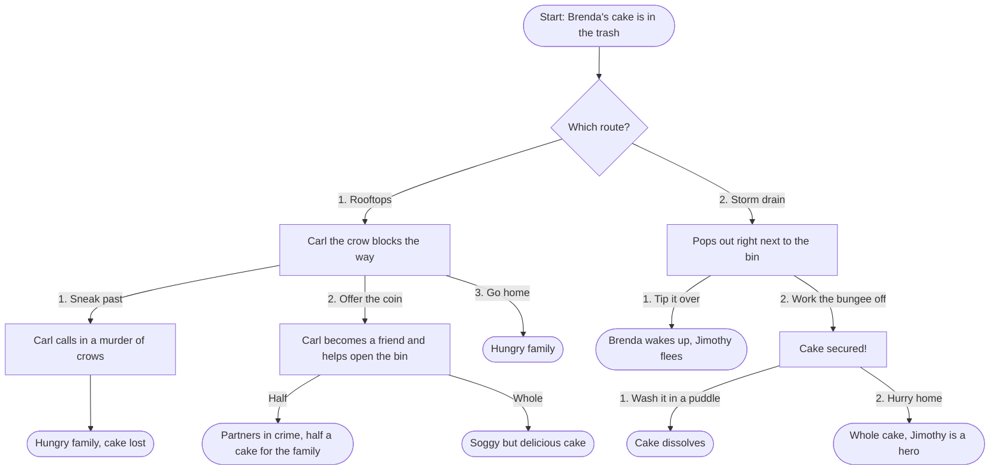

# Jimothy's Cake-scapades 🦝🎂

```
              .-.-.
     _(\-/)_" ,.  ,\  .-.
    {((O^O))} ../, ,|/__|
    `-.(Y).-` , | , |-.-`
       \-//-\,_. \ \`
       ////    / /\ \
     ==`==`   ==`   ==`

          Jimothy
```

A choose-your-own-adventure game for the terminal, written in Python.

Jimothy is a young raccoon who has finally earned the right to bring food home to his family den. One afternoon he watches Brenda throw out a completely untouched cake after her 40th birthday party, which is frankly a crime. That night, through a rainstorm, he sets out to stage a cake heist.

Every choice you make sends Jimothy down a different path. Some end with a family going to bed fat and happy. Some do not.

## How to play

You'll need Python 3. No extra packages required.

```bash
git clone https://github.com/cstandifer/hello-world-week-3.git
cd hello-world-week-3
python3 jimothys_cakescapades.py
```

Press **Enter** to move the story along. When Jimothy reaches a decision, type the option shown in the prompt (like `1`, `2`, or `Half`) and press Enter. If he doesn't understand you, he'll let you know and ask again.

## The cast

| | |
|---|---|
| **Jimothy** | Raccoon, short tail, big heart, carries a lucky coin |
| **Carl** | A crow. Jimothy once stole his french fry. Crows never forget a face. |
| **Brenda** | Just turned 40. Throws away perfectly good cake. Light sleeper. |
| **Jimothy's family** | Waiting back at the den, hoping for dessert |

## What's in the game

- **2 routes** to the garbage can: across the rooftops or through the storm drain
- **7 different endings**, from triumphant to tragic to slightly soggy
- **A score, an inventory, and a friends list** that change based on your choices and are tallied up when the game ends
- **ASCII art** for Jimothy, Carl, the cake, the coin, the rainstorm, and Brenda's garbage can

Can you find the ending with the highest score?

## Story map

Every path through the cake heist, from the first choice to all 7 endings. Best saved until after you've played.

<details>
<summary><strong>Full story map (spoilers!)</strong></summary>

<br>



| Ending | Score |
|---|---|
| Split the cake with Carl | 150 |
| Haul the whole soggy cake home with Carl's help | 150 |
| Bring the whole cake home through the storm drain | 100 |
| Every other ending | 0 |

</details>

## Built with

- Python 3
- A dictionary for the player (location, items, friends, score)
- Functions for each scene, with `while` loops that keep asking until you enter a valid choice

Made by [Caitlin Standifer](https://github.com/cstandifer) as a week 3 project in the Interaction Design MFA at SVA.
